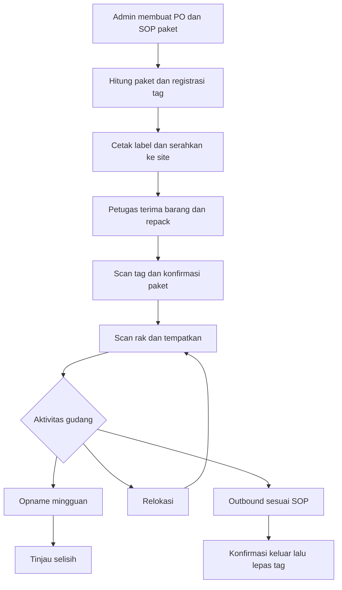
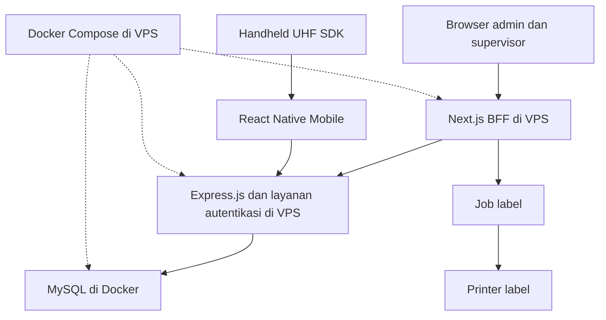
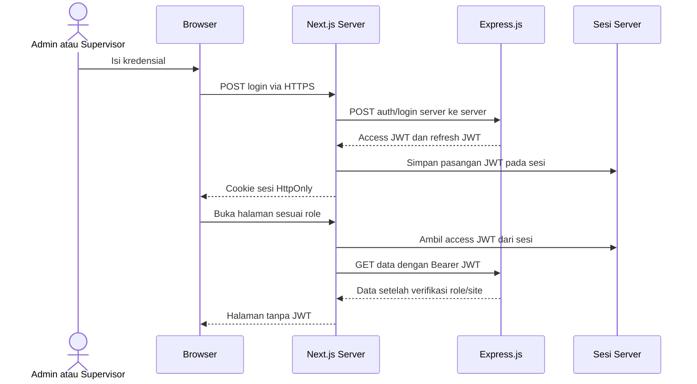
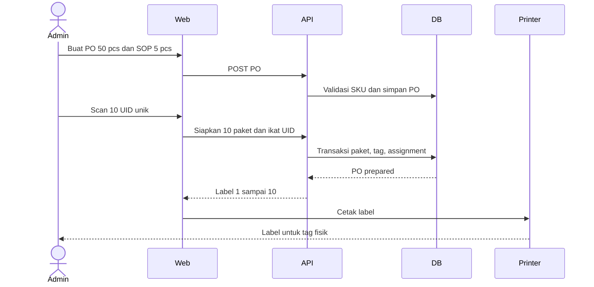
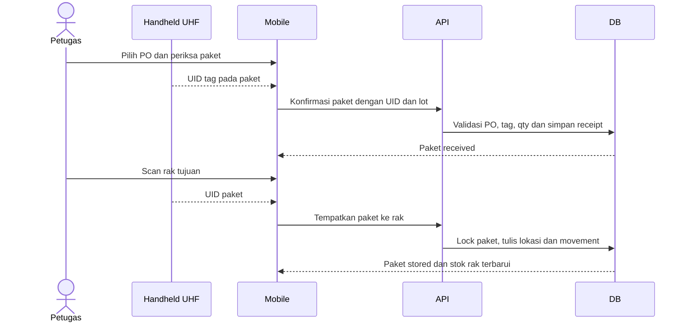
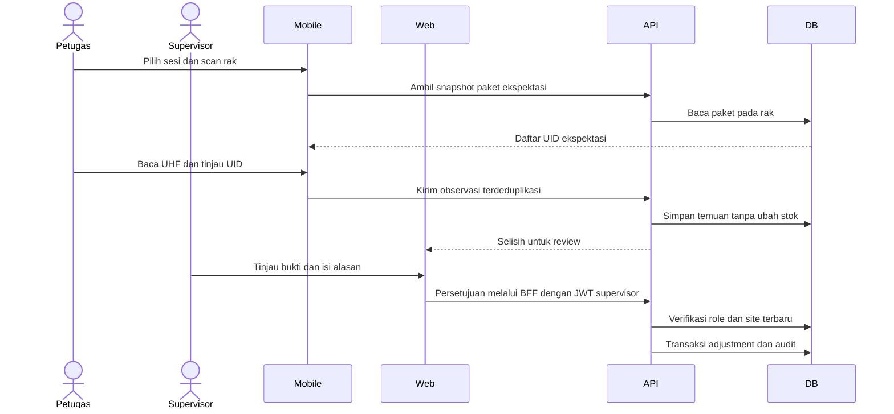
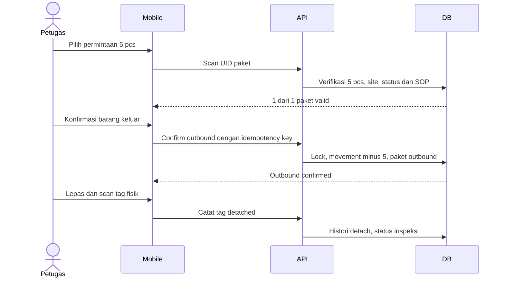
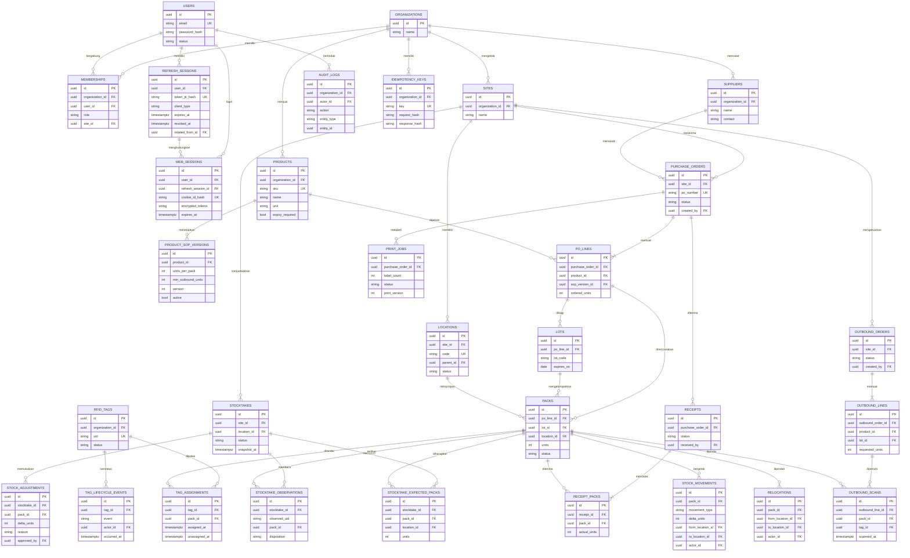
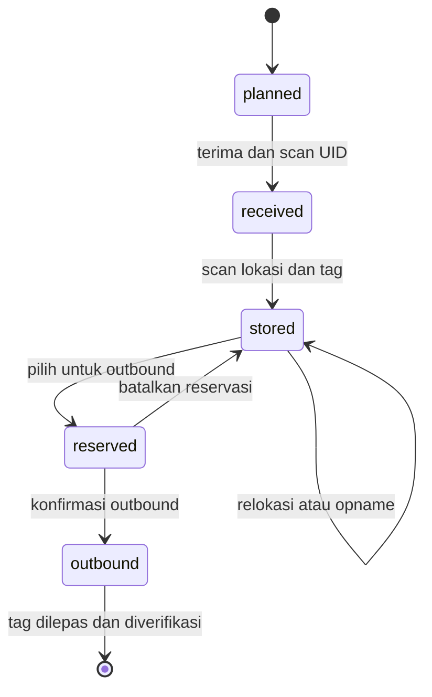

# Product Requirements Document KOMAR Inventory Management

**Versi:** Draft 1.2 · 9 November 2026  
**Audiens:** Product owner, admin gudang, tim web, tim mobile, backend, QA, dan operasional lapangan  
**Status:** Untuk peninjauan alur dan keputusan perangkat yang tersisa

## 1. Ringkasan dan keputusan produk

KOMAR Inventory Management menghubungkan persiapan purchase order (PO) dan tag RFID oleh admin dengan pekerjaan petugas di lokasi: menerima dan mengepak ulang barang, menempatkan paket ke rak, melakukan opname, merelokasi paket, dan mengeluarkan barang. Web Next.js dipakai admin dan supervisor dengan akses yang berbeda; aplikasi React Native yang **sudah ada** dipakai petugas lapangan dengan handheld UHF. API Express.js dan MySQL berjalan sebagai service Docker pada lingkungan developer dan VPS. Sistem mencatat satu tag aktif per paket fisik, lokasi paket, dan setiap perubahan stok agar barang bisa ditelusuri dari PO hingga tag dilepas setelah outbound.

**Contoh acuan:** Produk susu 250 ml, PO 50 pcs, SOP 5 pcs per paket/outbound. Sistem menyiapkan **10 paket dan 10 tag**, masing-masing mewakili 5 pcs. Nilai 5 pcs adalah konfigurasi produk, bukan konstanta seluruh katalog. Tanggal kedaluwarsa opsional pada entri PO, tetapi jika produk mewajibkannya, tanggal tersebut wajib diisi pada lot saat penerimaan.

Dokumen ini menggantikan isi template kasir/penjualan sebelumnya dengan kebutuhan inventori yang tampak pada visual dan keterangan sumber. Checkout kasir, invoice penjualan, dashboard developer untuk analitik transaksi merchant, AI rekomendasi penjualan, dan notifikasi Fonnte tidak menjadi syarat MVP KOMAR; semuanya memerlukan kebutuhan bisnis tersendiri jika kemudian diminta. Analitik MVP membahas penerimaan, posisi stok, opname, dan outbound. SEO diterapkan pada halaman publik web; halaman internal tetap privat.

## 2. Masalah, sasaran, dan batas MVP

Saat ini admin menyiapkan PO, jumlah tag, dan label, sementara petugas menerima, menempel tag, serta memindahkan barang secara fisik. Tanpa ikatan konsisten antara tag, paket, lot, rak, dan pergerakan, stok sistem mudah berbeda dari stok di lapangan dan asal barang sulit ditelusuri.

**Sasaran MVP:** setiap paket dapat ditelusuri; satu pemindaian sah menghasilkan satu perubahan status; penempatan membutuhkan rak valid; opname mingguan menghasilkan selisih yang dapat ditinjau; outbound menegakkan SOP kuantitas produk dan mempertahankan jejak pelepasan tag.

**Di dalam MVP:** katalog dan SOP produk; PO dan rincian lot; rekomendasi jumlah paket/tag; registrasi tag dan label; penerimaan aktual; repacking; penempatan rak; daftar stok; opname mingguan; relokasi; permintaan dan pemindaian outbound; pelepasan tag; status operasional dan audit. **Setelah MVP:** prediksi AI, notifikasi WhatsApp/Fonnte, mode offline penuh, integrasi ERP/penjualan, pengembalian barang, serta optimasi multi-gudang lanjutan.

## 3. Peran dan otorisasi

| Peran | Tanggung jawab | Akses utama |
|---|---|---|
| Admin | Kelola produk, SOP, PO, tag, label, rak, permintaan outbound, rekonsiliasi | Web admin; seluruh data pada organisasi/site yang ditugaskan |
| Site employee | Konfirmasi penerimaan, repack, scan paket/rak, opname, relokasi, outbound, lepas tag | Aplikasi mobile pada site yang ditugaskan |
| Supervisor | Tinjau dan setujui selisih opname, pengecualian barang, dan koreksi terotorisasi | **Web saja**; tidak diberi akses operasional admin atau aplikasi mobile |
| Platform operator | Dukungan teknis dan observabilitas | Metadata operasional terbatas; akses tenant harus diaudit |

Backend internal mengelola identitas dengan pasangan **JWT access token dan JWT refresh token**. Peran dan keanggotaan organisasi/site disimpan dalam MySQL. Web admin dan supervisor memakai login yang sama tetapi hak API, menu, dan aksi ditentukan oleh role. **Admin tidak otomatis berhak menyetujui penyesuaian yang mensyaratkan supervisor; supervisor tidak dapat mengubah katalog, PO, tag, atau label.** Petugas mobile tidak dapat membuka route supervisor. Semua operasi menolak akses lintas organisasi dan site yang tidak ditugaskan. Perubahan stok hanya melalui perintah server yang memvalidasi identitas, peran, site, dan status.

| Aksi | Admin web | Supervisor web | Site employee mobile |
|---|:---:|:---:|:---:|
| Kelola produk, SOP, PO, tag, label, rak | Ya | Lihat sesuai site | Tidak |
| Buat permintaan outbound dan lihat analitik | Ya | Lihat dan review | Lihat tugas terkait |
| Terima, tempatkan, scan opname, relokasi, keluar, lepas tag | Tidak | Tidak | Ya |
| Setujui selisih opname/pengecualian | Tidak | Ya | Tidak |
| Kelola user dan penugasan role/site | Ya dengan izin khusus | Tidak | Tidak |

Tabel akses ini menjadi kontrak backend. Menyembunyikan tombol/menu di frontend hanya membantu UX; endpoint tetap memeriksa izin yang sama.

## 4. Alur kerja yang disempurnakan

### 4.1 Web admin menyiapkan PO

1. Admin membuat produk/SKU, satuan dasar pcs, **units_per_pack**, **min_outbound_units**, dan apakah tanggal kedaluwarsa diwajibkan; perubahan SOP berlaku untuk paket baru, tidak mengubah paket yang sudah dibuat.
2. Admin membuat PO dengan pemasok, site tujuan, produk, jumlah unit, lot/expiry bila diketahui, dan catatan repack/penempatan. Dalam contoh, 50 ÷ 5 menghasilkan 10 paket. Jika jumlah tidak habis dibagi ukuran paket, admin mengubah PO atau mencatat pengecualian yang memerlukan keputusan supervisor; sistem tidak membuat paket pecahan diam diam.
3. Admin mendaftarkan tepat 10 UID tag unik lewat reader admin yang tersedia, memasangkan satu tag ke satu rencana paket, lalu mencetak label yang menampilkan SKU, nama, lot/expiry, ukuran paket, nomor paket, dan kode verifikasi yang sesuai tag. Tag fisik dan label harus dicocokkan sebelum diserahkan.
4. PO berpindah dari `draft` ke `prepared` setelah jumlah tag dan label sesuai. PO yang dibatalkan melepas alokasi tag yang belum dipakai dengan jejak audit.

### 4.2 Mobile menerima dan menempatkan

1. Petugas memilih PO/site, memeriksa jumlah fisik dan lot, mengepak ulang berdasarkan catatan admin, lalu memindai tag pada paket. UI menampilkan produk, isi paket, expiry, dan instruksi label untuk konfirmasi visual.
2. Sistem menolak UID tak dikenal, tag ganda, tag yang terikat pada paket lain, produk/lot yang tidak cocok, dan scan dari site lain. Selisih fisik dicatat sebagai exception; admin/supervisor memutuskan koreksi PO atau penerimaan parsial.
3. Setelah paket diterima, petugas memindai kode rak/slot dengan handheld yang mendukungnya atau kode QR pada rak sebagai fallback yang didefinisikan perangkat, lalu memindai tag paket; UI menunjukkan rak tujuan sebelum konfirmasi.
4. Penempatan berhasil hanya jika tag berstatus `received`, rak aktif di site yang benar, dan kapasitas/aturan lokasi terpenuhi bila konfigurasi kapasitas digunakan. Pergerakan dicatat dan paket berstatus `stored`.

### 4.3 Mobile opname dan relokasi

1. Supervisor menjadwalkan satu sesi opname per site atau zona setiap minggu. Petugas memilih rak, memindai rak, lalu membaca tag UHF di area terkontrol; hasil dipisahkan menjadi cocok, hilang dari rak, tidak terdaftar, dan salah lokasi.
2. Antarmuka meminta petugas meninjau bacaan yang tertangkap dari rak tetangga. Scan berulang UID sama dihitung sekali per sesi. Draft hasil boleh disimpan; penyelesaian sesi tidak langsung mengubah saldo.
3. Supervisor meninjau selisih, melakukan hitung ulang bila perlu, lalu menyetujui penyesuaian melalui transaksi tercatat dengan alasan; paket/tag yang hilang diinvestigasi dan dapat dikarantina.
4. Untuk relokasi, petugas scan rak asal, tag paket, dan rak tujuan, lalu konfirmasi. Perintah server memindahkan lokasi dalam satu transaksi dan mencatat `from_location` dan `to_location`; tidak ada perubahan jumlah unit.

### 4.4 Mobile outbound dan pelepasan tag

1. Admin membuat permintaan outbound untuk site, SKU, lot jika perlu, dan jumlah unit. Jumlah harus memenuhi **min_outbound_units** produk serta kelipatan **units_per_pack** untuk paket utuh pada MVP. Sebagai contoh, 5, 10, atau 15 pcs dari produk contoh berarti 1, 2, atau 3 paket; 3 pcs ditolak.
2. Petugas memilih permintaan, memindai tag paket yang `stored` pada site sesuai. Server memeriksa UID unik, produk/lot, status, expiry sesuai kebijakan, dan bahwa total unit yang dipilih tidak melampaui permintaan. Stok dikunci/dipesan selama konfirmasi.
3. Ketika kuantitas scan sama dengan permintaan, petugas mengonfirmasi barang keluar. Server menulis outbound dan ledger stok secara atomik, menandai paket `outbound`, serta menyimpan waktu/pelaku/site.
4. **Sesudah** konfirmasi keluar, petugas melepas tag fisik, memindainya ke proses `detached`, dan memasukkannya ke wadah penggunaan ulang. Tag baru boleh `available` setelah inspeksi/validasi ulang. Jika pelepasan belum tercatat, outbound tetap sah tetapi kasus masuk daftar tindak lanjut; tag belum boleh digunakan ulang.

## 5. Persyaratan fungsional dan kriteria penerimaan

| ID | Prioritas | Kebutuhan dan hasil yang dapat diuji |
|---|---|---|
| FR01 | Must | Admin membuat/ubah SKU dengan ukuran paket dan minimum outbound > 0; versi SOP tersimpan pada setiap paket. |
| FR02 | Must | PO 50 pcs dengan 5 pcs/paket menghasilkan 10 rencana paket/tag; input yang tidak habis dibagi ditolak atau diberi jalur pengecualian yang disetujui. |
| FR03 | Must | UID RFID unik secara global; tag yang sudah aktif tidak dapat dipasangkan ke dua paket. |
| FR04 | Must | Cetak ulang label memiliki penanda versi/job dan tidak membuat tag/paket baru. |
| FR05 | Must | Mobile membaca UID dari handheld UHF yang sudah dipakai; kegagalan reader, izin, dan koneksi tampil dengan tindakan ulang. |
| FR06 | Must | Penerimaan mencatat jumlah aktual, lot, expiry bila wajib, pelaku, waktu, dan selisih PO. |
| FR07 | Must | Penempatan mensyaratkan scan lokasi valid dan scan paket; hasil langsung terlihat pada stok per rak. |
| FR08 | Must | Opname menyimpan snapshot ekspektasi, daftar UID teramati yang terdeduplikasi, dan selisih; hanya supervisor dapat menyetujui adjustment. |
| FR09 | Must | Relokasi atomik mengubah lokasi paket tanpa mengubah kuantitas total. |
| FR10 | Must | Outbound menolak paket yang salah site, sudah keluar, UID ganda, atau tidak memenuhi SOP; total scan harus tepat sesuai permintaan saat konfirmasi. |
| FR11 | Must | Pelepasan dan penggunaan ulang tag memiliki status dan histori; tag outbound yang belum dilepas tidak bisa dialokasikan. |
| FR12 | Must | Riwayat setiap paket menunjukkan PO → diterima → rak → relokasi/opname → keluar → tag dilepas. |
| FR13 | Should | Filter stok per SKU, lot, expiry, lokasi, status, dan ekspor ringkasan untuk admin. |
| FR14 | Should | Admin melihat pekerjaan tertunda: PO belum diterima, paket belum ditempatkan, selisih opname, tag belum dilepas. |
| FR15 | Must | Login web menyimpan pasangan JWT hanya di server; browser menerima cookie sesi HttpOnly, bukan token; refresh berotasi dan logout mencabut sesi. |
| FR16 | Must | API membedakan role dan channel: supervisor hanya web untuk approval; admin dan petugas mendapat 403 pada approval, supervisor mendapat 403 pada aksi admin/mobile. |
| FR17 | Must | Mobile menyimpan refresh JWT di penyimpanan aman perangkat, menghapusnya saat logout, dan tidak mencatat token pada log. |
| FR18 | Must | Developer baru dapat menjalankan database, migrasi, API, dan web dari panduan multi-repo dengan Docker Compose, lalu menghubungkan handheld ke API lokal tanpa mengubah source code. |

**Skenario penerimaan utama:** PO 50 pcs → 10 paket, 10 UID unik → 10 label → penerimaan 10 paket → penempatan semua paket → stok tersedia 50 pcs. Outbound 5 pcs dengan satu UID mengurangi stok tersedia menjadi 45 pcs; UID yang sama ditolak jika di-scan ulang. Opname rak yang semestinya memuat 3 paket tetapi terbaca 2 menghasilkan selisih 1 paket/5 pcs dalam status review, tanpa langsung mengurangi stok.

## 6. Antarmuka dan pengalaman pengguna

**Web Next.js:** admin mengakses produk dan SOP, daftar/detail PO, registrasi UID dan antrean cetak label, manajemen site/rak, stok dan histori, permintaan outbound, serta dashboard pekerjaan tertunda. Supervisor mengakses antrean selisih opname/pengecualian, detail bukti, persetujuan/penolakan dengan alasan, dan ringkasan stok; route dan tindakan pengelolaan admin tidak tersedia baginya. Desain modern bernuansa gelap; status tidak dibedakan hanya lewat warna, tabel dapat disaring dan dinavigasi dengan keyboard, form menampilkan validasi unit dan konfirmasi tindakan yang mengubah stok.

**Mobile React Native yang sudah ada:** tambahkan/rapikan layar daftar tugas, detail PO penerimaan, pemindaian paket, pemindaian lokasi, opname, relokasi, outbound, dan pelepasan tag. Setiap layar scan menampilkan UID yang terbaca, identitas produk/paket, jumlah pcs, rak, dan status berikutnya. Pembaca UHF dapat menangkap beberapa tag sekaligus; operasi berisiko stok harus memakai pemilihan UID eksplisit, deduplikasi, dan konfirmasi. Integrasi native reader mempertahankan adapter perangkat lama dan menambahkan kontrak API scan yang dapat diuji.

**SEO:** halaman publik seperti beranda produk dan bantuan memiliki judul/deskripsi, canonical, sitemap, robots, dan pratinjau berbagi. Route login, dashboard, API, dan informasi stok diberi `noindex` serta proteksi autentikasi. SEO tidak mengubah visibilitas data privat.

## 7. Arsitektur dan kontrak integrasi

Next.js App Router dan React Native berbagi kontrak API Express.js. Web memakai shadcn/ui dan Tailwind untuk komponen admin/supervisor dengan tema gelap; mobile tetap mengikuti sistem komponen aplikasi yang sudah ada. **Express.js adalah satu service layer** yang menjalankan validasi domain, otorisasi, dan transaksi; klien tidak menulis langsung ke tabel stok atau status paket. MySQL dikelola sebagai service Docker dengan foreign key, unique constraint, indeks, migrasi, backup, dan pemantauan. File label/ekspor disimpan di penyimpanan privat VPS atau object storage yang dikelola sendiri bila diperlukan; file bukan sumber kebenaran stok. Reverse proxy HTTPS memisahkan web, API, dan akses database; port MySQL tidak dibuka untuk publik.

Docker Compose menjalankan web, API, dan database dengan konfigurasi berbeda untuk pengembangan lokal dan VPS. Image web/API dibangun dari repo masing-masing. Aplikasi React Native dipasang pada perangkat atau emulator dan memanggil API yang dapat dijangkau dari perangkat; handheld UHF dan printer label diuji pada perangkat/host yang sesungguhnya. Container tidak menjadi pengganti runtime Android atau integrasi perangkat fisik.

### 7.1 Autentikasi dan sesi web

1. Browser mengirim kredensial ke endpoint login Next.js melalui HTTPS. Next.js server memanggil Express.js `/auth/login`; **access JWT dan refresh JWT diterima dan disimpan di sisi server web**, terkait satu sesi web. Browser hanya menerima ID sesi acak dalam cookie `HttpOnly`, `Secure`, `SameSite`, dengan masa berlaku dan batas domain/path yang sesuai. Browser tidak menerima kedua JWT dalam respons, JavaScript, localStorage, atau sessionStorage.
2. Pada request web berikutnya, Next.js membaca cookie di server, mengambil sesi server, dan meneruskan access JWT ke Express.js. Saat access JWT kedaluwarsa, Next.js melakukan refresh **server ke server**, mengganti pasangan token sesi setelah refresh token diputar, lalu melanjutkan permintaan. Redis di VPS boleh dipakai sebagai penyimpanan sesi terenkripsi/terbatas; bila tanpa Redis, gunakan tabel `web_sessions` MySQL. Kunci enkripsi dan signing disimpan di secret server, bukan dalam bundle web.
3. Logout mencabut sesi web dan keluarga refresh token terkait. Perubahan role/site mencabut sesi atau memaksa otorisasi ulang. Semua route Next.js terlindungi; Express.js memeriksa role dan penugasan terbaru untuk aksi sensitif, termasuk approval supervisor. Mutasi berbasis cookie dilindungi dari CSRF dengan SameSite dan pemeriksaan origin/token anti-CSRF.

### 7.2 Autentikasi mobile dan batasan perangkat

Mobile tidak mempunyai server perantara seperti browser web. Setelah login ke Express.js melalui HTTPS, aplikasi menyimpan **refresh JWT di Keychain/Keystore perangkat**, bukan AsyncStorage; access JWT singkat hanya disimpan dalam memori bila memungkinkan. Aplikasi mengirim access JWT pada header `Authorization`, memutar refresh JWT melalui `/auth/refresh`, dan menghapus kredensial saat logout. Server menyimpan hash identitas refresh token, status, serta rantai rotasi untuk mendeteksi pemakaian ulang dan mencabut keluarga token. Untuk role `supervisor`, login mobile ditolak meskipun kredensial benar; petugas hanya mendapat izin site yang ditugaskan. Karena aplikasi mobile menghubungi API secara langsung, token mobile tidak mungkin seluruhnya berada di server; perlindungan perangkat ini adalah batas keamanan yang eksplisit.

**Parameter rancangan:** access JWT berumur pendek (contoh 10–15 menit); refresh JWT memiliki masa hidup terbatas sesuai kebijakan operasional pilot dan diputar pada setiap refresh. JWT memuat `sub`, `sid`, `jti`, `iss`, `aud`, `iat`, `exp` dan konteks role/site minimum. Password disimpan sebagai hash kuat; login diberi pembatasan percobaan. Validasi signature, issuer, audience, expiry, status sesi, dan izin dilakukan di API. Masa hidup final dan kebijakan logout semua perangkat ditetapkan sebelum pilot.

**Kontrak utama (rancangan):** `POST /auth/login`, `POST /auth/refresh`, `POST /auth/logout`, `GET /auth/me`; `POST /purchase-orders`, `POST /purchase-orders/{id}/prepare`, `POST /tag-registrations`, `POST /receipts/{id}/confirm-pack`, `POST /packs/{id}/place`, `POST /stocktakes/{id}/observations`, `POST /stocktakes/{id}/submit`, `POST /stocktakes/{id}/approve-adjustments` (**supervisor web saja**), `POST /relocations`, `POST /outbound-orders`, `POST /outbound-orders/{id}/scan`, `POST /outbound-orders/{id}/confirm`, `POST /tags/{id}/detach`; `GET` untuk katalog, PO, stok, histori, dan tugas. Perintah mutasi memakai `Idempotency-Key`; server mengembalikan hasil lama untuk retry dengan kunci yang sama dan menolak payload berbeda.

**Keamanan dan keandalan:** setiap perintah memverifikasi JWT internal, membership organisasi/site, role, dan status sesi; koneksi database serta kunci penandatanganan hanya berada di server. Akses database melalui service layer dengan query tenant/site yang dibatasi dan diuji; constraint dan akses user MySQL terbatas dapat dipakai sebagai pertahanan berlapis bila implementasinya sesuai. Lock baris paket/tag saat scan dan konfirmasi, tulis status serta `stock_movements` dalam transaksi yang sama, dan simpan audit pelaku/waktu/alasan. Jangan menjalankan outbound atau adjustment saat offline pada MVP; UI menyimpan draft lokal yang belum dianggap berhasil dan menawarkan retry aman setelah koneksi pulih. Timestamp UTC di database, ditampilkan sesuai zona site. Backup database harus diuji dengan pemulihan pada lingkungan terpisah.

### 7.3 Lingkungan Docker untuk developer dan VPS

**Layout monorepo:** `apps/web` dan `apps/api` berada pada satu repository; root menyimpan `compose.yml`, `.env.example`, `README.md`, dan dokumentasi lintas aplikasi pada `docs/`. Aplikasi mobile tetap repository/runtime terpisah dan tidak dimasukkan ke container. Setiap aplikasi tetap dapat dibangun sendiri dari direktorinya.

| Lingkungan | Layanan Compose | Perilaku |
|---|---|---|
| Developer lokal | `db`, `api`, `web`, satu job `migrate`; `redis` hanya jika sesi web memakainya | Source web/API bisa di-bind mount atau Compose Watch, volume database persisten, port web/API hanya untuk lokal; healthcheck database dan API. |
| VPS staging/produksi | `db`, `api`, `web`, `migrate` satu kali, proxy HTTPS/backup sesuai infrastruktur | Image immutable dari commit/tag, tanpa mount source code, secret terpisah, restart policy, volume database dan backup, database di network privat. |
| Mobile native | Tidak wajib menjadi layanan Compose | React Native build/Metro di host; API base URL mengarah ke host yang dapat diakses emulator/handheld, bukan nama service internal Docker. |

**Kontrak file minimal:** `apps/web` menyediakan `Dockerfile` multi-stage dan `.dockerignore` untuk build Next.js; `apps/api` menyediakan `Dockerfile`, `.dockerignore`, dependency lock, perintah start Express.js dan perintah migrasi. Root menyediakan Compose, `.env.example` tanpa kredensial asli, panduan bootstrap, reset data lokal, dan troubleshooting. `.env` dan file secret asli diabaikan oleh Git. Kunci JWT, password database, serta enkripsi sesi tidak dimasukkan ke image, Compose yang di-commit, atau variabel `NEXT_PUBLIC_*`.

**Alur onboarding yang ditargetkan:** clone monorepo → salin root `.env.example` menjadi `.env` dan isi secret dev → `docker compose up --build -d` → cek healthcheck, login akun demo, dan jalankan skenario PO 50/5 → untuk mobile, atur URL API yang dapat dijangkau perangkat dan jalankan build native pada handheld. README root mencantumkan command yang tepat sesuai nama service nyata, versi Docker/Compose minimum yang diuji, serta perbedaan host API pada emulator dan perangkat fisik.

**Syarat operasional:** `api` menunggu database sehat dan tetap menangani reconnect; `web` menunggu API sehat. Proses migrasi gagal harus menghentikan rollout, bukan mengulang migrasi diam diam pada setiap startup container. Volume MySQL tidak terhapus oleh `docker compose down` biasa; reset data lokal menggunakan perintah yang diberi label jelas. Backup VPS disimpan terpisah dari volume database dan diuji restore. Port MySQL tidak diekspos ke internet. Printer lokal diakses melalui browser atau layanan print bridge yang diputuskan saat integrasi perangkat, bukan asumsi bahwa container bisa membuka USB host.

## 8. Diagram urutan interaksi utama

### 8.0 Login web dan penggunaan token di server

Saat JWT kedaluwarsa, BFF meminta `/auth/refresh` dari server, menyimpan token baru, dan mencabut token lama. Mobile memakai alur login langsung ke Express.js, menyimpan refresh JWT di Keychain/Keystore, dan hanya diberi role `site_employee`.

### 8.1 Persiapan PO dan tag

### 8.2 Penerimaan dan penempatan

### 8.3 Opname dan persetujuan selisih

### 8.4 Outbound dan daur ulang tag

## 9. Model data dan ERD

Skema berikut memakai `uuid` untuk ID internal dan user lokal, `organization_id` sebagai batas tenant, waktu `timestamptz`, jumlah unit bilangan bulat positif, dan `version` untuk penguncian optimistis bila perlu. `USERS` menyimpan hash password, bukan password mentah; `REFRESH_SESSIONS` menyimpan hash pengenal token dan status rotasi; `WEB_SESSIONS` menyimpan referensi sesi cookie dan pasangan JWT yang dienkripsi di sisi server. Semua tabel bisnis bertenant memiliki foreign key organisasi, indeks untuk FK dan filter site/status, serta audit `created_at`, `updated_at` bila relevan. Detail constraint, indeks, otorisasi query tenant, dan migrasi SQL diselesaikan saat implementasi.

**Constraint penting:** `(organization_id, sku)` unik; `(site_id, location_code)` unik; `rfid_tags.uid` unik setelah normalisasi format EPC; satu assignment aktif per tag dan satu tag aktif per paket melalui unique partial index `WHERE unassigned_at IS NULL`; `(stocktake_id, observed_uid)` unik; `(outbound_line_id, pack_id)` unik; nomor PO unik per organisasi; units paket > 0; total unit paket yang disiapkan = unit PO yang disetujui; satu paket hanya berisi satu SKU dan satu lot. `REFRESH_SESSIONS` membatasi satu `jti` aktif per rotasi dan dapat mencabut satu keluarga sesi saat replay terdeteksi; `WEB_SESSIONS` kedaluwarsa dan dicabut saat logout. Role admin, supervisor, dan site employee dibatasi dengan check/enum dan izin API; perubahan membership memicu invalidasi sesi. `stock_movements` bersifat append only dan memakai `delta_units` untuk penerimaan/outbound/adjustment; relokasi menyimpan dua lokasi dengan `delta_units = 0`. `packs.status` dan lokasi adalah proyeksi operasional yang diperbarui dalam transaksi ledger yang sama, lalu direkonsiliasi berkala. Snapshot opname membekukan daftar ekspektasi pada saat mulai agar perubahan paralel setelahnya dapat ditandai dan dihitung ulang.

## 10. Status dan aturan transisi

Tag bergerak `available → assigned → attached → detach_pending → detached → inspection → available`; tag rusak berakhir `retired`. PO bergerak `draft → prepared → partially_received/received → closed`, dengan `cancelled` hanya jika tidak ada stok aktif tanpa proses pembatalan terotorisasi. Outbound bergerak `draft → picking → confirmed`, dan pembatalan sebelum confirmed melepaskan reservasi. Setelah confirmed, koreksi dilakukan melalui transaksi pembalik yang diaudit, bukan menghapus histori.

## 11. Analitik, nonfungsional, dan indikator keberhasilan

Dashboard admin menampilkan jumlah PO siap/parsial, unit dan paket per SKU/site/rak, paket yang belum ditempatkan, near expiry berdasarkan ambang yang dikonfigurasi, sesi opname jatuh tempo, selisih belum selesai, outbound hari ini, dan tag menunggu pelepasan. KPI pilot: 100% paket yang diterima memiliki UID unik; 100% mutasi stok mempunyai pelaku dan riwayat; tidak ada outbound ganda pada retry; selisih opname memiliki status penyelesaian; waktu untuk menemukan lokasi paket dapat diukur dari pencarian sampai rak ditampilkan. Target angka waktu dan akurasi ditentukan setelah baseline pilot.

Persyaratan kualitas: respons scan menampilkan status segera setelah server mengonfirmasi; bila jaringan gagal, tidak menampilkan sukses palsu. Target performa, volume tag serentak, retensi audit, RPO/RTO, dan frekuensi backup ditentukan dari jumlah site dan SLA pilot. Uji perangkat memakai handheld UHF yang sudah dimiliki, printer label aktual, kondisi tag berdekatan, rak bersebelahan, sinyal lemah, dan percobaan scan berulang. Monitoring merekam error API, kegagalan reader/printer, latency command, dan anomali ledger; data personal dan token tidak masuk log.

## 12. Backlog implementasi per repo

Web dan mobile adalah **repo terpisah**. Item backend berikut menjadi kontrak bersama dan ditempatkan pada repo API tersendiri; jika API sudah ada, tambahkan modul/migrasi di repo tersebut. Setiap item punya hasil yang dapat diuji dan dependensi yang jelas. Tidak ada task web yang meminta modifikasi source mobile, dan sebaliknya.

### 12.1 Repo backend dan infrastruktur VPS

| ID | Task | Kriteria selesai |
|---|---|---|
| BE01 | Siapkan MySQL sebagai service Docker, migrasi skema, backup dan uji restore | Database privat, migrasi dapat dijalankan ulang, pemulihan berhasil di staging |
| BE02 | Implementasi user lokal, hash password, JWT access/refresh, refresh rotation, revoke, dan sesi web | Login/refresh/logout valid, replay refresh ditolak, role/site berubah mencabut sesi |
| BE03 | Middleware otorisasi role, tenant/site, serta batas channel web/mobile | Supervisor hanya diterima untuk endpoint web yang diizinkan; 403 pada endpoint admin/mobile |
| BE04 | API katalog, SOP versi, PO, rencana paket, UID unik, label dan job cetak | PO 50/5 menghasilkan tepat 10 paket/tag; UID duplikat ditolak |
| BE05 | API penerimaan, penempatan, ledger stok dan histori | Penerimaan dan penempatan atomik, stok dan posisi rak konsisten |
| BE06 | API opname snapshot, observasi, review supervisor dan adjustment | Scan ganda terdeduplikasi; approval hanya JWT supervisor dengan site sesuai |
| BE07 | API relokasi, permintaan outbound, scan/konfirmasi, detach dan inspeksi tag | Perintah idempoten; outbound mengurangi stok sekali dan tag tidak reuse prematur |
| BE08 | Dokumentasikan OpenAPI, contoh error, Idempotency-Key, integrasi dan monitoring | Kontrak dapat dipakai dua repo klien tanpa menebak payload/status |
| BE09 | Tambahkan `Dockerfile` multi-stage, `.dockerignore`, perintah migrasi dan health endpoint | Image API build dari lockfile; migrasi sebagai job terpisah; healthcheck tidak bergantung pada data demo |

### 12.2 Repo web Next.js

| ID | Task | Kriteria selesai |
|---|---|---|
| WEB01 | Bangun login/logout Next.js BFF dan cookie sesi aman; token JWT hanya di server | DevTools browser tidak menunjukkan access/refresh JWT; login/refresh/logout berhasil |
| WEB02 | Terapkan layout, navigasi, dan route guard berbeda admin/supervisor | Supervisor tidak melihat atau menjalankan aksi admin; akses langsung tetap 403 dari API |
| WEB03 | Halaman katalog, SOP per produk, PO, rencana paket, registrasi UID, dan cetak label | Kasus 50/5 menampilkan 10 label dan UID yang tepat |
| WEB04 | Halaman site/rak, stok, histori paket, permintaan outbound, dan dashboard tertunda | Filter dan status sesuai data backend, tanpa akses site lain |
| WEB05 | Workspace supervisor untuk review selisih, bukti scan, approval/reject dan alasan | Approval memakai sesi supervisor; admin tidak dapat submit melalui UI/API |
| WEB06 | Tema gelap shadcn/ui, aksesibilitas, SEO hanya halaman publik | Halaman privat noindex dan terproteksi; alur keyboard dan kontras diperiksa |
| WEB07 | Uji integrasi BFF dengan API, refresh serentak, CSRF, dan kedaluwarsa sesi | Retry aman; token tidak bocor ke HTML, log, atau JavaScript browser |
| WEB08 | Tambahkan `Dockerfile` multi-stage, `.dockerignore`, build produksi dan konfigurasi server-only | Image Next.js dapat dibangun dari repo web; secret/JWT tidak masuk bundle atau layer image |

### 12.3 Repo mobile React Native yang sudah ada

| ID | Task | Kriteria selesai |
|---|---|---|
| MOB01 | Audit adapter SDK handheld UHF yang sudah ada; bungkus event scan dan deduplikasi | UID akurat saat banyak tag berdekatan; scan berulang tidak membuat mutasi ganda |
| MOB02 | Login/refresh/logout Express.js dan penyimpanan refresh JWT di Keychain/Keystore | Petugas dapat login; supervisor ditolak; token tidak masuk AsyncStorage/log |
| MOB03 | Layar daftar tugas, penerimaan PO, repack, konfirmasi tag/lot/expiry | Selisih penerimaan terlihat dan tidak otomatis dianggap stok sah |
| MOB04 | Layar scan lokasi dan penempatan paket | Salah site/rak/status ditolak, stok rak diperbarui saat konfirmasi |
| MOB05 | Layar opname per rak, review UID, kirim observasi dan status review | Scan ganda sekali; mobile tidak memiliki tombol/endpoint approval supervisor |
| MOB06 | Layar relokasi, outbound sesuai SOP, konfirmasi, lepas tag dan inspeksi | Total scan tepat, outbound idempoten, tag dilepas sesudah konfirmasi |
| MOB07 | Penanganan sinyal lemah, timeout, izin reader, sesi kedaluwarsa dan uji perangkat | Tidak ada sukses palsu ketika API gagal; draft dan retry jelas bagi petugas |
| MOB08 | Dokumentasikan setup Android/handheld, URL API lokal, dan konfigurasi environment per build | Developer baru login dan scan UID pada handheld dengan API Compose; tanpa URL hard-coded dalam aplikasi |

### 12.4 Repo konfigurasi pengembangan dan deployment

| ID | Task | Kriteria selesai |
|---|---|---|
| DEV01 | Buat `compose.yaml` untuk `db`, `api`, `web`, `migrate` dan opsi `redis`; build context dari repo sejajar | `docker compose config` valid dan healthcheck mengurutkan startup |
| DEV02 | Buat `.env.example`, contoh secret dev dan README setup/seed/reset/troubleshooting | Developer baru dapat mengikuti alur onboarding tanpa meminta kredensial produksi |
| DEV03 | Buat konfigurasi VPS terpisah dengan image bertag, network privat, volume, backup dan proxy HTTPS | Tidak ada database publik, kode bind mount atau secret nyata yang di-commit |
| DEV04 | Jalankan smoke test Compose lintas repo di mesin bersih | Login web, API health, migrasi dan skenario 50/5 berhasil; perangkat mobile dapat mencapai API |

### 12.5 Urutan integrasi dan pilot

1. BE01–BE03, BE09, WEB01–WEB02, WEB08, DEV01–DEV02, dan MOB01–MOB02/MOB08 memvalidasi fondasi auth, container, channel, perangkat, dan kontrak API.
2. BE04–BE05 bersama WEB03 dan MOB03–MOB04 membuktikan alur PO 50/5 sampai stok 50 pcs di rak.
3. BE06 bersama WEB05 dan MOB05 membuktikan supervisor web menyetujui selisih yang berasal dari scan mobile.
4. BE07 bersama WEB04 dan MOB06 membuktikan outbound 5 pcs tepat sekali dan tag tidak tersedia sebelum inspeksi.
5. WEB06–WEB07, BE08, MOB07, serta DEV03–DEV04 menutup isu kualitas dan deployment, lalu pilot satu site merekonsiliasi stok fisik dengan sistem.

## 13. Asumsi dan pertanyaan untuk finalisasi

**Dikonfirmasi:** aplikasi React Native lapangan sudah ada; pembaca adalah handheld UHF. Aturan 5 pcs pada contoh adalah SOP produk dan dapat berbeda antarproduk. Autentikasi memakai JWT access/refresh token internal, tanpa Clerk; data dan API di VPS, tanpa Supabase. Supervisor memakai web dengan hak yang berbeda dari admin. Docker diminta untuk memudahkan developer lain menjalankan layanan lintas repo.

**Asumsi kerja untuk rancangan:** satu tag aktif per paket repack; paket tidak dibelah saat outbound MVP; rak diberi kode yang dapat dipindai; admin menyiapkan tag/label sebelum penerimaan; outbound dilakukan oleh petugas lewat mobile; label dapat dicetak dari web melalui jalur printer yang tersedia. Ini adalah keputusan desain yang perlu diuji bersama alur fisik saat pilot.

**Keputusan tersisa:** (1) model handheld UHF, SDK, OS, dan cara membaca kode rak; (2) apakah SOP 5 pcs berarti wajib keluar dalam kelipatan 5 pada seluruh kasus, serta siapa yang boleh menyetujui paket parsial; (3) metode reader RFID dan printer label di meja admin; (4) format SKU/lot, FEFO/expiry dan larangan produk kedaluwarsa; (5) jumlah site dan lokasi; (6) apakah transfer antar-site, retur, dan operasi offline dibutuhkan pada pilot; (7) apakah AI dan Fonnte memang masuk roadmap KOMAR atau hanya berasal dari template kasir; (8) apakah Express.js/MySQL sudah berjalan sebagai layanan terpisah di VPS atau akan dibuat pada repo API baru; (9) target remote Git untuk monorepo baru, karena remote `legacy-backend` hanya referensi historis. **Diputuskan:** web dan API berada dalam satu monorepo dengan Compose di root; tidak ada repo koordinator terpisah. Pertanyaan ini tidak menghalangi peninjauan rancangan, tetapi memengaruhi acceptance criteria final.

## 14. Rujukan teknologi

- Next.js App Router dan metadata/robots untuk halaman publik: https://nextjs.org/docs/app/getting-started/metadata-and-og-images dan https://nextjs.org/docs/app/api-reference/file-conventions/metadata/robots
- Next.js server side authentication dan BFF: https://nextjs.org/docs/app/guides/authentication dan https://nextjs.org/docs/app/guides/backend-for-frontend
- OWASP manajemen sesi browser dan penyimpanan token mobile: https://cheatsheetseries.owasp.org/cheatsheets/Session_Management_Cheat_Sheet dan https://mas.owasp.org/MASTG/0x04e-Testing-Authentication-and-Session-Management/
- RFC 9700 mengenai rotasi refresh token pada public client: https://datatracker.ietf.org/doc/html/rfc9700
- Docker Compose untuk startup, konfigurasi pengembangan, secret, dan produksi: https://docs.docker.com/compose/how-tos/startup-order/ ; https://docs.docker.com/reference/compose-file/develop/ ; https://docs.docker.com/compose/how-tos/use-secrets/ ; https://docs.docker.com/compose/how-tos/production/
- Setup perangkat React Native: https://reactnative.dev/docs/set-up-your-environment

Versi paket Next.js, React Native, shadcn/ui, Express.js, dan MySQL dipilih dari rilis stabil yang kompatibel saat implementasi, lalu dikunci di lockfile. PRD ini tidak mengikat angka versi yang cepat berubah.
