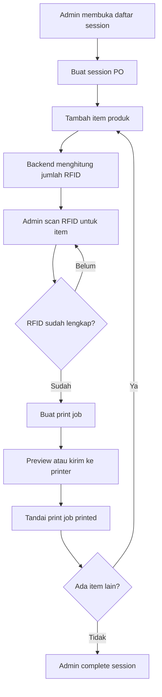

# Panduan Frontend — Session PO, RFID, dan Label

Dokumen ini adalah kontrak kerja untuk frontend dashboard admin. Gunakan dokumen ini untuk membangun halaman, form, tombol, state, validasi, dan integrasi API dari awal sampai akhir.

> **Tujuan utama:** admin membuat satu session PO, memasukkan banyak barang, sistem menghitung kebutuhan RFID per barang, admin memindai RFID, membuat label, mencetak label, lalu menutup session secara manual.

---

## 1. Konsep bisnis yang harus dipahami frontend

### 1.1 Istilah

| Istilah | Arti |
|---|---|
| **Produk** | Barang pada katalog, misalnya `Susu Putih 250 ml`. |
| **Session PO** | Wadah satu pekerjaan persiapan PO. Satu session dapat memiliki banyak item barang. |
| **Item session** | Satu produk yang dimasukkan ke dalam session PO. |
| **Paket rencana / pack plan** | Satu paket fisik yang nantinya memiliki satu RFID dan satu label. |
| **RFID** | UID/tag fisik hasil scanner. Satu RFID hanya boleh untuk satu paket rencana aktif. |
| **Print job** | Data label yang siap dipreview, dikirim ke print bridge, atau dicetak dari browser. |

### 1.2 Contoh utama

```text
Session: PO-2026-001

Item: Susu Putih 250 ml
Kemasan supplier: 1 pack = 12 pcs
Order supplier: 50 pack
Total fisik hasil backend: 50 × 12 = 600 pcs
Repack / minimum outbound pada item: 5 pcs
Expiry: 2026-12-31 (opsional)

Kebutuhan RFID = 600 / 5 = 120 RFID

Hasil:
- Paket 1: 5 pcs + RFID A + 1 label
- Paket 2: 5 pcs + RFID B + 1 label
...
- Paket 120: 5 pcs + RFID + 1 label
```

### 1.3 Aturan paling penting

1. Nilai `min_outbound_units` **didefinisikan admin pada katalog produk**. Angka `5` hanya contoh, bukan angka tetap.
2. Backend menghitung `ordered_quantity = ordered_supplier_pack_quantity × supplier_pack_units_snapshot`; hasilnya wajib habis dibagi `min_outbound_units`.
3. Satu RFID = satu paket fisik = satu label.
4. Expiry diisi per item dan berlaku untuk seluruh paket dari item tersebut.
5. Expiry memakai tanggal saja: `YYYY-MM-DD`, tanpa jam.
6. Label item yang sudah selesai dicetak **tidak menutup session**.
7. Session tetap `active`, sehingga admin boleh menambah item baru kapan pun sebelum session ditutup manual.
8. Session hanya dapat `completed` jika semua item di dalamnya sudah memiliki label tercetak.

### 1.4 Kapan UID RFID boleh digunakan kembali

Gunakan lifecycle berikut sebagai aturan utama. Status `inventory_movements`
yang dipakai adalah movement terakhir untuk UID tersebut, bukan sekadar adanya
riwayat lama.

| Kondisi UID | Boleh dipakai untuk product/PO baru? | Tindakan |
|---|---:|---|
| Belum pernah masuk session/pack plan | Ya | UID baru didaftarkan otomatis lalu di-assign oleh scan Admin. |
| Sudah masuk session atau `unplaced` | Tidak | Jangan assign ke item lain; UID masih terikat pada pack plan lama. |
| `placed` | Tidak | Gunakan proses relokasi atau lifecycle inventory yang sesuai. |
| `relocation` | Tidak | Tunggu sampai lifecycle berikutnya selesai. |
| Saat proses `outbound`/`trash` berlangsung | Tidak | Tunggu transaksi terminal berhasil dan assignment dilepas. |
| Setelah `outbound`/`trash` berhasil | Ya | UID kembali `available` dan boleh di-assign ke pack baru. |
| Assignment dilepas secara resmi sebelum placement | Ya | UID kembali `available` dan boleh dipakai ulang. |

UID tidak pernah boleh dibuat sebagai record kedua. Reuse selalu menggunakan
record RFID yang sama setelah syarat lifecycle terpenuhi.

---

## 2. Base URL, respons umum, dan ID

### 2.1 Base URL

Untuk development lokal:

```text
http://localhost:3000
```

Simpan pada environment frontend, misalnya:

```env
NEXT_PUBLIC_API_BASE_URL=http://localhost:3000
```

atau pada aplikasi lain gunakan nama environment sesuai framework yang dipakai.

Semua endpoint di bawah memakai prefix `/api`, misalnya:

```text
GET http://localhost:3000/api/products
```

### 2.2 CORS untuk frontend pada origin berbeda

Backend mengizinkan browser frontend dari origin pada environment backend `CORS_ORIGINS`. Default development adalah:

```env
CORS_ORIGINS=http://localhost:3001,http://127.0.0.1:3001
```

Jika Next.js berjalan pada `http://localhost:3001`, frontend boleh memanggil API langsung:

```js
fetch('http://localhost:3000/api/products');
```

Jika port atau domain Next.js berbeda, tambahkan origin lengkapnya ke `CORS_ORIGINS`, pisahkan dengan koma, lalu restart API Docker. Contoh:

```env
CORS_ORIGINS=http://localhost:3001,http://127.0.0.1:3001,https://admin.example.com
```

Jangan gunakan `*` untuk environment production. Backend saat ini tidak mengaktifkan cookie/credentials lintas origin.

### 2.3 Bentuk respons berhasil

Sebagian besar endpoint menggunakan bentuk berikut:

```json
{
  "success": true,
  "data": {}
}
```

Beberapa endpoint scan mengembalikan hasil per UID, bukan hanya `data`:

```json
{
  "success": true,
  "total_requested": 2,
  "total_assigned": 2,
  "total_errors": 0,
  "remaining_rfid_count": 118,
  "results": [],
  "errors": []
}
```

### 2.4 Bentuk respons gagal

```json
{
  "success": false,
  "message": "Validation failed.",
  "errors": [
    {
      "field": "min_outbound_units",
      "message": "Total 12 pcs from 1 supplier pack cannot be evenly divided into repack units of 5."
    }
  ]
}
```

### 2.5 ID yang perlu disimpan frontend

| Nama ID | Digunakan untuk |
|---|---|
| `product.id` | Menambah item ke session. |
| `poSession.id` | Membuka detail session, menambah item, complete/cancel. |
| `poSessionItem.id` | Scan RFID, lihat progress, buat print job. |
| `poPackPlan.id` | Lepas RFID salah scan atau cetak ulang satu label. |
| `labelPrintJob.id` | Mengambil data label dan menandai hasil cetak. |
| `rfidTag.id` | Referensi RFID; umumnya tidak perlu dipilih manual oleh admin. |

> ID session, item, pack plan, dan print job adalah UUID. ID RFID saat ini berupa integer.

---

## 3. Status dan aturan tombol UI

### 3.1 Status session

```text
active → completed
active → cancelled
```

| Status | Arti | Tombol yang boleh tampil |
|---|---|---|
| `active` | Session masih dikerjakan. | Ubah session, tambah item, scan RFID, buat label, complete, cancel bila memenuhi syarat. |
| `completed` | Admin sudah menutup session. | Detail dan riwayat saja. Jangan tampilkan tambah/edit/scan. Cetak ulang label masih dapat ditawarkan bila dibutuhkan. |
| `cancelled` | Session dibatalkan. | Detail/riwayat saja. |

**Penting:** Jangan mengubah status session menjadi selesai di frontend hanya karena satu item sudah dicetak. Hanya API `complete` yang menutup session.

### 3.2 Status item session

```text
pending_tags → ready_to_print → printed
```

| Status | Arti | UI yang disarankan |
|---|---|---|
| `pending_tags` | RFID belum lengkap. | Tampilkan progres scan dan tombol Scan RFID. |
| `ready_to_print` | Semua RFID sudah terpasang. | Tampilkan tombol Buat Label / Cetak Label. |
| `printed` | Semua label item sudah ditandai tercetak. | Tampilkan badge selesai dan tombol Cetak Ulang per paket. |
| `cancelled` | Item berasal dari session dibatalkan. | Read-only. |

### 3.3 Status paket rencana

```text
pending_tag → tag_assigned → label_printed
```

| Status | Arti | Aksi frontend |
|---|---|---|
| `pending_tag` | Belum ada UID RFID. | Menunggu hasil scan. |
| `tag_assigned` | RFID sudah dipasangkan, label belum ditandai tercetak. | Boleh lepas RFID jika salah scan; boleh masuk print job. |
| `label_printed` | Label sudah tercetak. | Tidak boleh lepas RFID lewat API biasa; boleh cetak ulang. |
| `cancelled` | Session dibatalkan. | Read-only. |

### 3.4 Status print job

```text
generated → printed
generated → cancelled
generated → failed
```

| Status | Arti | Aksi frontend |
|---|---|---|
| `generated` | Data label berhasil dibuat backend, belum dikonfirmasi tercetak. | Preview, kirim ke printer, atau tandai printed setelah berhasil. |
| `printed` | Printer sudah sukses dan dikonfirmasi. | Tampilkan riwayat cetak. |
| `failed` | Status cadangan untuk integrasi print bridge di masa depan. API saat ini belum menyediakan endpoint untuk mengubah job menjadi `failed`. | Tampilkan informasi gagal bila status ini diterima; jangan mengirim `mark-printed`. |
| `cancelled` | Job tidak lagi valid, misalnya RFID dilepas sebelum dicetak. | Jangan dicetak. |

---

## 4. Alur halaman dashboard admin

### 4.1 Rekomendasi halaman

| Halaman | Tujuan | API utama |
|---|---|---|
| Katalog produk | Melihat dan mengelola produk. | `/api/products` |
| Daftar session PO | Mencari, membuat, dan membuka session. | `/api/po-sessions` |
| Detail session PO | Menambah item dan melihat seluruh progres. | `/api/po-sessions/:id` |
| Form item session | Memasukkan produk, jumlah supplier, expiry; konfigurasi repack diambil dari produk. | `POST /api/po-sessions/:id/items` |
| Scan RFID | Menampilkan kebutuhan, UID masuk, error, dan sisa tag. | `POST /api/po-session-items/:id/rfid-scans` |
| Preview/cetak label | Menampilkan label dan memicu print. | `/api/print-jobs/:id` |

### 4.2 Alur pengguna lengkap



---

## 5. API katalog produk

Produk wajib tersedia sebelum dapat dimasukkan ke session.

### 5.1 Ambil daftar produk

```http
GET /api/products
```

**Digunakan ketika:**

- halaman katalog produk dibuka;
- form tambah item menampilkan combobox/pencarian produk.

**Respons ringkas:**

```json
{
  "success": true,
  "data": [
    {
      "id": "a5e2a649-0a2f-4ce2-ae59-b4c7b8e4fa01",
      "sku": "SUSU-250",
      "name": "Susu Putih 250 ml",
      "base_unit": "pcs",
      "supplier_pack_units": 12,
      "supplier_pack_label": "pack",
      "min_outbound_units": 5,
      "expiry_required": false,
      "status": "active"
    }
  ]
}
```

**Aturan UI:** tampilkan hanya produk dengan `status: "active"` sebagai pilihan input item baru.

> **Produk legacy:** produk lama dapat memiliki `supplier_pack_units: null` sampai admin melengkapi datanya. Jangan izinkan produk tersebut dipilih untuk item PO baru. Minta admin memperbarui produk terlebih dahulu; backend juga akan menolak pembuatan item bila nilai ini belum valid.

### 5.2 Buat produk

```http
POST /api/products
Content-Type: application/json
```

```json
{
  "sku": "SUSU-250",
  "name": "Susu Putih 250 ml",
  "base_unit": "pcs",
  "supplier_pack_units": 12,
  "supplier_pack_label": "pack",
  "min_outbound_units": 5,
  "expiry_required": false
}
```

**Digunakan ketika:** produk belum tersedia dalam katalog.

**Validasi backend:**

- `sku`, `name`, `supplier_pack_units`, dan `min_outbound_units` wajib.
- SKU unik.
- `supplier_pack_units` dan `min_outbound_units` masing-masing harus integer positif.
- Tidak ada aturan kelipatan antara kemasan supplier dan repack gudang. Contoh supplier `12 pcs` dan repack `5 pcs` valid.

### 5.3 Detail, ubah, dan hapus produk

```http
GET    /api/products/:productId
PUT    /api/products/:productId
DELETE /api/products/:productId
```

**Catatan penting:**

- `PUT` menggunakan payload produk lengkap atau field yang ingin diubah sesuai kontrak API produk.
- Produk yang sudah dipakai proses inventori sebaiknya diubah menjadi `inactive`, bukan dihapus.
- `supplier_pack_units` dan `min_outbound_units` berasal dari produk terpilih dan tidak dikirim ulang pada payload item PO. PO menyimpan keduanya sebagai snapshot agar histori tidak berubah ketika katalog diedit.
- Jika `supplier_pack_label` tidak dikirim saat membuat produk baru, backend menggunakan nilai aplikasi `"pack"`. Field ini boleh bernilai `null` untuk histori legacy.
- Field legacy `units_per_pack` tidak lagi dikirim oleh API produk dan tidak boleh dipakai frontend untuk kalkulasi baru.
- `expiry_required` saat ini adalah informasi katalog. Backend session masih mengizinkan `expires_on` kosong karena expiry disepakati opsional.

---

## 6. API RFID umum

Endpoint ini bukan alur utama scan session, tetapi tetap tersedia untuk inventaris RFID umum.

### 6.1 Daftar RFID

```http
GET /api/rfid
```

**Digunakan ketika:** halaman inventaris RFID ingin menampilkan UID dan status tag.

### 6.2 Mendaftarkan RFID sebagai stok tersedia

```http
POST /api/rfid
Content-Type: application/json
```

```json
{
  "rfid_tags": [
    "E2806894000040168D432183",
    "E2806894000040168D43218C"
  ]
}
```

**Digunakan ketika:** admin ingin memasukkan stok UID RFID terlebih dahulu tanpa menghubungkannya ke item PO.

**Jangan gunakan endpoint ini untuk scan dari halaman item PO.** Untuk scan yang langsung memasangkan RFID dengan paket barang, gunakan endpoint di bagian 9.

### 6.3 Detail dan hapus RFID

```http
GET    /api/rfid/:rfidId
DELETE /api/rfid/:rfidId
```

RFID hanya dapat dihapus bila masih tersedia dan belum dipasangkan ke paket/session lain.

---

## 7. API session PO

### 7.1 Daftar session

```http
GET /api/po-sessions
```

**Digunakan ketika:** halaman daftar session dimuat atau direfresh.

Data respons berisi session dan ringkasan item. Backend saat ini belum menyediakan pagination atau filter server-side; frontend perlu menangani pencarian/filter tampilan secara lokal sampai API filter ditambahkan.

### 7.2 Buat session baru

```http
POST /api/po-sessions
Content-Type: application/json
```

```json
{
  "session_number": "PO-2026-001",
  "reference_number": "PO-SUPPLIER-001",
  "notes": "Persiapan penerimaan barang minggu ini"
}
```

| Field | Wajib | Keterangan |
|---|---:|---|
| `session_number` | Ya | Nomor session unik. Backend menormalisasi menjadi huruf besar. |
| `reference_number` | Tidak | Nomor PO supplier atau referensi lain. |
| `notes` | Tidak | Catatan admin. |

**Digunakan ketika:** admin menekan tombol **Buat Session PO**.

**Respons inti:**

```json
{
  "success": true,
  "data": {
    "id": "SESSION_UUID",
    "session_number": "PO-2026-001",
    "reference_number": "PO-SUPPLIER-001",
    "status": "active"
  }
}
```

Setelah sukses, arahkan admin ke halaman detail session menggunakan `data.id`.

### 7.3 Detail session

```http
GET /api/po-sessions/:sessionId
```

**Digunakan ketika:** halaman detail session dibuka, selesai menambah item, selesai scan, atau selesai print.

Respons detail berisi:

- data session;
- `items`;
- `items[].packPlans`;
- RFID yang terpasang pada setiap pack plan;
- ringkasan `labelPrintJobs`.

Catatan teknis:

- `labelPrintJobs` pada detail session hanya ringkasan job. Ambil `GET /api/print-jobs/:printJobId` untuk snapshot label lengkap.
- Respons item lama dapat masih mengandung `units_per_rfid_pack` untuk kompatibilitas database. Abaikan field tersebut; sumber ukuran repack adalah `min_outbound_units` dan `packPlans[].units`.

Contoh struktur yang disederhanakan:

```json
{
  "success": true,
  "data": {
    "id": "SESSION_UUID",
    "session_number": "PO-2026-001",
    "status": "active",
    "items": [
      {
        "id": "ITEM_UUID",
        "product_name_snapshot": "Susu Putih 250 ml",
        "ordered_supplier_pack_quantity": 50,
        "supplier_pack_units_snapshot": 12,
        "supplier_pack_label_snapshot": "pack",
        "ordered_quantity": 600,
        "min_outbound_units": 5,
        "expires_on": "2026-12-31",
        "required_rfid_count": 120,
        "status": "ready_to_print",
        "packPlans": [
          {
            "id": "PACK_PLAN_UUID",
            "sequence_number": 1,
            "units": 5,
            "status": "tag_assigned",
            "label_code": "LBL-...",
            "rfidTag": {
              "id": 1,
              "rfid_number": "E2806894000040168D432183",
              "status": "assigned_to_po"
            }
          }
        ]
      }
    ]
  }
}
```

### 7.4 Ubah metadata session

```http
PATCH /api/po-sessions/:sessionId
```

Contoh:

```json
{
  "reference_number": "PO-SUPPLIER-001-REV-1",
  "notes": "Tanggal kedatangan berubah"
}
```

**Digunakan ketika:** admin hanya perlu mengubah nomor referensi atau catatan session.

Hanya session berstatus `active` yang boleh diubah.

### 7.5 Batalkan session

```http
POST /api/po-sessions/:sessionId/cancel
```

**Digunakan ketika:** session aktif harus dibatalkan sebelum ada label yang benar-benar tercetak.

**Aturan:**

- RFID yang telah terpasang tetapi belum dicetak akan dilepas kembali ke status tersedia.
- Session dengan label `label_printed` ditolak untuk pembatalan otomatis.
- Session `completed` tidak dapat dibatalkan melalui endpoint ini.

**UI:** tampilkan modal konfirmasi dengan penjelasan bahwa assignment RFID yang belum dicetak akan dilepas.

### 7.6 Selesaikan session secara manual

```http
POST /api/po-sessions/:sessionId/complete
```

**Digunakan ketika:** admin yakin tidak ada item baru yang perlu ditambahkan dan seluruh item sudah selesai dicetak.

Backend menolak jika satu atau lebih item belum `printed`.

**UI:**

- Tombol **Selesaikan Session** hanya aktif bila semua item berstatus `printed`.
- Tetap panggil API; validasi frontend hanya membantu UX, backend adalah sumber kebenaran.
- Setelah sukses, ubah tampilan session menjadi read-only.

---

## 8. API item di dalam session

### 8.1 Tambah item

```http
POST /api/po-sessions/:sessionId/items
Content-Type: application/json
```

```json
{
  "product_id": "PRODUCT_UUID",
  "ordered_supplier_pack_quantity": 50,
  "expires_on": "2026-12-31",
  "notes": "Simpan pada rak pendingin"
}
```

| Field | Wajib | Format / aturan |
|---|---:|---|
| `product_id` | Ya | UUID produk aktif dari katalog. |
| `ordered_supplier_pack_quantity` | Ya | Jumlah pack yang dipesan dari supplier, contoh `50`. |
| `expires_on` | Tidak | `YYYY-MM-DD` atau `null`. |
| `notes` | Tidak | Catatan item. |

**Digunakan ketika:** admin menekan **Tambah Barang** pada detail session.

**Perhitungan frontend:**

```text
estimatedOrderedQuantity = ordered_supplier_pack_quantity × product.supplier_pack_units
estimatedRfid = estimatedOrderedQuantity / product.min_outbound_units
```

Tampilkan preview seperti:

```text
50 pack × 12 pcs = 600 pcs
600 pcs ÷ 5 pcs = 120 RFID diperlukan
```

Namun hasil API tetap sumber kebenaran.

**Respons inti:**

```json
{
  "success": true,
  "data": {
    "id": "ITEM_UUID",
    "ordered_supplier_pack_quantity": 50,
    "supplier_pack_units_snapshot": 12,
    "supplier_pack_label_snapshot": "pack",
    "ordered_quantity": 600,
    "min_outbound_units": 5,
    "required_rfid_count": 120,
    "status": "pending_tags"
  },
  "required_rfid_count": 120,
  "message": "120 RFID pack plans were created."
}
```

### 8.2 Ubah item sebelum scan

```http
PATCH /api/po-session-items/:itemId
```

**Digunakan ketika:** admin salah memasukkan produk, jumlah order, expiry, atau catatan, tetapi belum ada RFID yang dipasangkan.

Kirim payload item lengkap:

```json
{
  "product_id": "PRODUCT_UUID",
  "ordered_supplier_pack_quantity": 100,
  "expires_on": null,
  "notes": "Revisi jumlah dari supplier"
}
```

Backend menghapus pack plan kosong sebelumnya dan membuat pack plan baru berdasarkan angka terbaru.

**Aturan UI:** sembunyikan/nonaktifkan tombol Edit jika item sudah mempunyai RFID. Jika tetap dipanggil, backend mengembalikan `409`.

### 8.3 Hapus item sebelum scan

```http
DELETE /api/po-session-items/:itemId
```

**Digunakan ketika:** item salah ditambahkan dan belum memiliki RFID yang terpasang.

**Aturan UI:**

- tampilkan konfirmasi;
- hanya aktif bila RFID terpasang masih `0`;
- refresh detail session setelah sukses.

---

## 9. API scan dan assignment RFID

### 9.1 Scan RFID untuk item

```http
POST /api/po-session-items/:itemId/rfid-scans
Content-Type: application/json
```

```json
{
  "rfid_tags": [
    "E2806894000040168D432183",
    "E2806894000040168D43218C"
  ]
}
```

**Digunakan ketika:** halaman scan menerima UID dari reader RFID untuk item yang sedang diproses.

Backend melakukan hal berikut secara atomik:

1. Menghapus spasi dan mengubah UID menjadi huruf besar.
2. Mengabaikan UID duplikat dalam request yang sama tanpa membuat assignment kedua.
3. Jika UID belum ada, membuat record RFID baru dengan status `available`, lalu mendaftarkannya ke paket berikutnya dalam transaksi yang sama. Respons sukses menandai `registered_now: true`.
4. Jika UID sudah ada tetapi `available`, memasangkannya ke paket berikutnya. Ini adalah jalur reuse setelah assignment dilepas atau lifecycle lama selesai.
5. Menolak UID yang sudah digunakan oleh proses lain atau belum dilepas dari lifecycle lama.
6. Memasangkan setiap UID yang valid ke `pack plan` kosong dengan nomor paket berurutan.

**Respons sukses contoh:**

```json
{
  "success": true,
  "total_requested": 2,
  "total_assigned": 2,
  "total_errors": 0,
  "ignored_duplicates": 0,
  "remaining_rfid_count": 118,
  "results": [
    {
      "index": 0,
      "rfid_number": "E2806894000040168D432183",
      "id": 1,
      "pack_plan_id": "PACK_PLAN_UUID_1",
      "pack_number": 1,
       "label_code": "LBL-...",
       "registered_now": true
    },
    {
      "index": 1,
      "rfid_number": "E2806894000040168D43218C",
      "id": 2,
      "pack_plan_id": "PACK_PLAN_UUID_2",
      "pack_number": 2,
      "label_code": "LBL-..."
    }
  ],
  "errors": []
}
```

**Respons campuran contoh:** UID valid tetap tersimpan walaupun ada UID bermasalah.

```json
{
  "success": true,
  "total_requested": 2,
  "total_assigned": 1,
  "total_errors": 1,
  "ignored_duplicates": 0,
  "remaining_rfid_count": 117,
  "results": [
    {
      "index": 0,
      "rfid_number": "E2806894000040168D432183",
      "pack_number": 3
    }
  ],
  "errors": [
    {
      "index": 1,
      "rfid_number": "E2806894000040168D43218C",
      "code": "RFID_ALREADY_ASSIGNED_TO_PO",
      "message": "RFID ini masih digunakan pada PO lain dan belum dapat digunakan kembali."
    }
  ]
}
```

### 9.2 Error scan yang perlu ditampilkan jelas

| `errors[].code` | Arti untuk admin | Perlakuan UI |
|---|---|---|
| `invalid_uid` | Reader mengirim UID kosong/tidak valid. | Tampilkan merah; jangan hitung sebagai scan berhasil. |
| `duplicate_in_request` | UID sama terbaca lebih dari sekali dalam satu submit. | Abaikan diam-diam; jangan tampilkan alert dan jangan membuat assignment kedua. |
| `RFID_DUPLICATE_IN_ITEM` | UID sudah dipakai pada item yang sedang diproses. | Tampilkan label DITOLAK pada modal Realtime RFID Scan. |
| `RFID_DUPLICATE_IN_SESSION` | UID sudah dipakai item lain dalam PO/session yang sama. | Tampilkan label DITOLAK dan minta admin memakai tag lain. |
| `RFID_ALREADY_ASSIGNED_TO_PO` | UID masih dipakai pada PO lain. | Tampilkan PO lama bila tersedia; lepaskan dahulu atau selesaikan lifecycle-nya. |
| `RFID_ALREADY_PLACED` | UID masih memiliki lifecycle placed/relocation. | Tampilkan DITOLAK; gunakan relokasi, outbound, atau trash sesuai kondisi barang. |
| `RFID_NOT_REGISTERED` | UID belum terdaftar pada flow yang memang mensyaratkan master lebih dahulu. | Pada Admin realtime PO, UID baru akan didaftarkan dan dipasangkan otomatis; pada flow placement/mobile, daftarkan melalui master RFID. |
| `RFID_REUSE_NOT_RELEASED` | UID masih terikat pada pack/lifecycle lama. | Lepaskan assignment atau selesaikan lifecycle outbound/trash sebelum assignment ulang. |
| `RFID_DATA_INCONSISTENT` | Riwayat movement dan assignment RFID tidak konsisten. | Hentikan pemakaian UID dan minta Admin melakukan rekonsiliasi data. |
| `no_remaining_pack` | Kebutuhan RFID item sudah penuh. | Hentikan scan dan arahkan ke label. |

Pada modal **REALTIME RFID SCAN**, hanya tampilkan dua hasil: `BERHASIL` atau
`DITOLAK`. Pembacaan berulang/duplikat tidak ditampilkan sebagai alert, tidak
menambah riwayat, dan tidak membuat assignment kedua. Error tidak perlu
ditampilkan sebagai alert global halaman. Orange Pi tetap mengirim event scan
seperti biasa; FE menerima hasil melalui `scan.result`.

### 9.3 Progress RFID

```http
GET /api/po-session-items/:itemId/rfid-progress
```

**Digunakan ketika:**

- halaman scan pertama kali dibuka;
- setelah request scan;
- kembali ke halaman detail item;
- perlu memulihkan state setelah refresh browser.

Contoh respons:

```json
{
  "success": true,
  "data": {
    "po_session_item_id": "ITEM_UUID",
    "required_rfid_count": 120,
    "assigned_rfid_count": 2,
    "remaining_rfid_count": 118,
    "status": "pending_tags"
  }
}
```

### 9.4 Realtime reader melalui WebSocket

Untuk reader USB Serial yang dibaca oleh gateway Orange Pi, frontend dapat membuat scan session:

```http
POST /api/po-session-items/:itemId/rfid-scan-sessions
Content-Type: application/json
```

```json
{
  "reader_code": "orangepi-reader-01"
}
```

Setelah session dibuat, dashboard terhubung ke WebSocket API pada path `/ws` dan
mengirim handshake. Untuk akses lokal gunakan `ws://<api-host>:3000/ws`.
Jika dashboard dibuka melalui Cloudflare, gunakan URL WSS API, bukan URL FE:

```env
NEXT_PUBLIC_RFID_WS_URL=wss://<api-tunnel>.trycloudflare.com/ws
```

`NEXT_PUBLIC_RFID_WS_URL` dibaca saat build Next.js. Setelah Quick Tunnel
mendapat URL baru, perbarui environment dan build/restart web kembali.

Contoh URL yang dipakai frontend:

```text
ws://localhost:3000/ws                         # lokal
wss://<api-tunnel>.trycloudflare.com/ws        # Cloudflare API tunnel
```

Jangan gunakan `ws://<frontend-tunnel>.trycloudflare.com/ws`,
`/api/ws`, atau port FE `3001`; WebSocket berada di API port `3000`.

Dashboard kemudian mengirim handshake:

```json
{
  "type": "hello",
  "role": "dashboard"
}
```

Lalu subscribe ke scan session:

```json
{
  "type": "subscribe",
  "scan_session_id": "SCAN_SESSION_UUID"
}
```

Backend mengirim `scan.result` setelah UID dari Orange Pi berhasil diproses.
Sumber kebenaran tetap endpoint progress/database; WebSocket hanya mengirim
perubahan realtime. Scan session dapat dihentikan dengan:

```http
POST /api/rfid-scan-sessions/:scanSessionId/stop
```

Jika gateway terputus, session ditandai `failed` dan admin dapat memulai scan
session baru.

### 9.5 Rekomendasi implementasi layar scan

1. Ambil progress saat halaman dibuka.
2. Tampilkan `2 / 120 RFID terpasang` dan `118 tersisa` untuk contoh susu 50 pack × 12 pcs dengan repack 5 pcs.
3. Tampung UID dari hardware reader dalam buffer lokal.
4. Deduplikasi UID pada buffer dengan `Set` sebelum mengirim request.
5. Kirim batch kecil, misalnya setiap tombol **Simpan Hasil Scan** atau setiap pembacaan stabil dari adapter reader.
6. Saat respons diterima:
   - masukkan `results` ke daftar berhasil;
   - masukkan `errors` ke daftar gagal;
   - gunakan `remaining_rfid_count` dari server;
   - hentikan reader bila sisa `0`.
7. Jangan tampilkan sukses sebelum respons backend diterima.

> Reader UHF dapat membaca UID berulang kali atau membaca tag di dekatnya. Frontend harus selalu menampilkan daftar UID yang akan disimpan dan memberi admin kesempatan menghapus UID dari buffer sebelum submit.

### 9.6 Lepas RFID salah scan

```http
DELETE /api/po-pack-plans/:packPlanId/rfid
```

**Digunakan ketika:** admin memasangkan UID ke paket yang salah, tetapi label belum ditandai tercetak.

Hasil:

- RFID kembali `available`;
- paket kembali `pending_tag`;
- item kembali `pending_tags`;
- print job `generated` yang mengandung paket tersebut dibatalkan agar label lama tidak dicetak.

**UI:** selalu tampilkan konfirmasi, termasuk UID RFID dan nomor paket yang akan dilepas.

---

## 10. API label dan printer

### 10.1 Buat print job untuk satu item

```http
POST /api/po-session-items/:itemId/print-jobs
Content-Type: application/json
```

```json
{
  "format": "pdf"
}
```

Format tersedia:

| `format` | Kapan dipakai |
|---|---|
| `pdf` | Browser menampilkan preview/print dialog atau aplikasi print bridge menerima PDF. |
| `zpl` | Printer Zebra atau print bridge yang menerima format ZPL. |

**Digunakan ketika:** semua RFID item sudah lengkap dan admin menekan **Buat Label**.

Backend menolak bila masih ada RFID yang belum terpasang. Jika item sudah memiliki
initial print job berstatus `generated` atau `printed`, backend mengembalikan job
yang sama dan tidak membuat row baru. Response untuk job baru adalah `201`, sedangkan
response untuk job yang digunakan ulang adalah `200` dengan `reused: true`.

### 10.2 Ambil data label dari print job

```http
GET /api/print-jobs/:printJobId
```

**Digunakan ketika:** halaman preview label dibuka atau print bridge membutuhkan data label.

Setiap `items[]` pada respons memiliki `label_snapshot`. Gunakan snapshot ini sebagai sumber data cetak, bukan data produk live, agar label tetap sesuai kondisi saat job dibuat.

Contoh `label_snapshot`:

```json
{
  "session_number": "PO-2026-001",
  "sku": "SUSU-250",
  "product_name": "Susu Putih 250 ml",
  "base_unit": "pcs",
  "units": 5,
  "pack_number": 1,
  "expiry_date": "2026-12-31",
  "rfid_uid": "E2806894000040168D432183",
  "label_code": "LBL-..."
}
```

`label_snapshot` saat ini menunjukkan hasil repack melalui `units`, contoh `5 pcs`. Data kemasan supplier (`50 pack × 12 pcs`) tidak ikut dicetak oleh backend secara default. Jika nantinya perlu dicetak, itu merupakan perubahan kontrak label baru, bukan nilai yang boleh diasumsikan frontend.

### 10.3 Urutan proses cetak yang benar

```text
1. POST print-jobs
2. GET print-jobs/:id
3. Frontend preview / kirim data ke printer atau print bridge
4. Printer sukses mencetak fisik
5. POST print-jobs/:id/mark-printed
6. Frontend refresh detail session
```

**Jangan memanggil `mark-printed` sebelum printer benar-benar sukses.** Jika browser gagal, printer offline, atau kertas habis, biarkan job tetap `generated` dan tawarkan tombol coba cetak lagi.

Untuk menghindari job ganda, nonaktifkan tombol **Buat Label** selama request sedang
berlangsung dan selama item sudah mempunyai print job `generated`. Backend juga
melindungi endpoint ini: request ulang untuk initial job yang sudah `generated` atau
`printed` menggunakan job yang sama. Endpoint **Cetak Ulang** tetap membuat job baru
dengan `job_type: reprint`.

### 10.4 Tandai print job sukses tercetak

```http
POST /api/print-jobs/:printJobId/mark-printed
```

**Digunakan ketika:** frontend/print bridge memperoleh konfirmasi bahwa proses cetak fisik berhasil.

Efek backend:

- print job menjadi `printed`;
- pack plan terkait menjadi `label_printed`;
- bila seluruh label item sudah tercetak, item menjadi `printed`;
- session **tetap `active`** sampai admin memanggil endpoint `complete`.

Endpoint ini aman dipanggil ulang untuk job yang sudah `printed`; backend mengembalikan sukses tanpa membuat perubahan tambahan. Tetap tampilkan konfirmasi pada aksi pertama karena status `printed` mengunci pelepasan RFID biasa.

### 10.5 Cetak ulang satu label

```http
POST /api/po-pack-plans/:packPlanId/reprint
Content-Type: application/json
```

```json
{
  "format": "pdf"
}
```

**Digunakan ketika:** label rusak, hilang, tinta buram, atau perlu dicetak ulang untuk satu RFID/paket tertentu.

Backend membuat print job versi baru, tetapi **tidak membuat RFID baru dan tidak membuat paket baru**.

UI yang disarankan:

- letakkan tombol **Cetak Ulang** pada setiap baris paket;
- tampilkan konfirmasi berisi nomor paket dan UID RFID;
- tampilkan penanda versi cetak dari data print job bila diperlukan.

---

## 11. Urutan pemanggilan API end-to-end

### 11.1 Persiapan satu produk dan satu session

```text
GET  /api/products
POST /api/po-sessions
POST /api/po-sessions/:sessionId/items
GET  /api/po-sessions/:sessionId
```

### 11.2 Scan sampai lengkap

```text
GET  /api/po-session-items/:itemId/rfid-progress
POST /api/po-session-items/:itemId/rfid-scans
POST /api/po-session-items/:itemId/rfid-scans
...
GET  /api/po-session-items/:itemId/rfid-progress
```

### 11.3 Cetak label

```text
POST /api/po-session-items/:itemId/print-jobs
GET  /api/print-jobs/:printJobId
POST /api/print-jobs/:printJobId/mark-printed
GET  /api/po-sessions/:sessionId
```

### 11.4 Tambah item baru setelah item lama sudah dicetak

```text
POST /api/po-sessions/:sessionId/items
POST /api/po-session-items/:newItemId/rfid-scans
POST /api/po-session-items/:newItemId/print-jobs
POST /api/print-jobs/:newPrintJobId/mark-printed
```

Hal ini valid selama status session masih `active`.

### 11.5 Menutup session

```text
POST /api/po-sessions/:sessionId/complete
```

### 11.6 Ringkasan teknis mutasi dan refresh state

Gunakan tabel ini sebagai aturan implementasi tombol/action di frontend. Setelah aksi yang bertanda **refresh**, panggil `GET /api/po-sessions/:sessionId` agar tabel item, status pack plan, dan ringkasan job kembali sinkron.

| Aksi FE | Request | Kondisi sebelum request | Respons sukses | Setelah sukses |
|---|---|---|---|---|
| Buat produk | `POST /api/products` | SKU belum ada; `supplier_pack_units > 0`; `min_outbound_units > 0`. | `201`, `data.id`. | Tambahkan produk ke cache/combobox. |
| Ubah produk | `PUT /api/products/:id` | Produk ada; lengkapi `supplier_pack_units` bila produk legacy. | `200`. | Refresh daftar produk. Snapshot item lama tidak berubah. |
| Buat session | `POST /api/po-sessions` | Nomor session unik. | `201`, `data.id`. | Navigasi ke detail session. |
| Tambah item | `POST /api/po-sessions/:id/items` | Session `active`; produk `active`; total hasil supplier pack habis dibagi repack. | `201`, `data`, `required_rfid_count`. | **Refresh** detail session. |
| Ubah item | `PATCH /api/po-session-items/:id` | Session `active`; tidak ada RFID terpasang; kirim payload item lengkap. | `200`. | **Refresh** detail session. |
| Hapus item | `DELETE /api/po-session-items/:id` | Session `active`; RFID terpasang `0`. | `200`. | **Refresh** detail session. |
| Simpan scan | `POST /api/po-session-items/:id/rfid-scans` | Session `active`; item belum `printed`; ada UID pada buffer. | `201` bila minimal satu UID terpasang; respons dapat berisi `errors`. | Update dari respons, lalu **refresh** bila perlu. |
| Lepas RFID | `DELETE /api/po-pack-plans/:id/rfid` | Session `active`; pack belum `label_printed`. | `200`. | **Refresh** detail session; jangan gunakan print job lama. |
| Buat print job | `POST /api/po-session-items/:id/print-jobs` | Session `active`; seluruh pack plan sudah punya RFID. | `201`, `data.id`. | Navigasi/ambil detail job. |
| Konfirmasi cetak | `POST /api/print-jobs/:id/mark-printed` | Printer fisik benar-benar sukses. | `200`. | **Refresh** detail session. |
| Cetak ulang | `POST /api/po-pack-plans/:id/reprint` | Pack memiliki RFID. | `201`, `data.id`. | Ambil detail job baru lalu cetak. |
| Complete | `POST /api/po-sessions/:id/complete` | Semua item `printed`. | `200`, session `completed`. | **Refresh** detail; ubah UI menjadi read-only. |
| Cancel | `POST /api/po-sessions/:id/cancel` | Session `active`; tidak ada pack `label_printed`. | `200`, session `cancelled`. | **Refresh** detail; ubah UI menjadi read-only. |

### 11.7 Kontrak payload item terbaru

Frontend **tidak boleh** mengirim `ordered_quantity` saat membuat atau mengubah item. Field itu hasil kalkulasi backend dan hanya dibaca dari respons.

```ts
type PoSessionItemInput = {
  product_id: string; // UUID produk aktif
  ordered_supplier_pack_quantity: number; // integer > 0
  expires_on?: string | null; // YYYY-MM-DD
  notes?: string | null;
};

type PoSessionItemComputed = {
  ordered_supplier_pack_quantity: number;
  supplier_pack_units_snapshot: number;
  supplier_pack_label_snapshot: string | null;
  ordered_quantity: number; // backend: supplier quantity × snapshot units
  min_outbound_units: number;
  required_rfid_count: number; // backend: ordered_quantity ÷ min_outbound_units
};
```

Jika backend mengembalikan `400` dengan field `min_outbound_units`, konfigurasi
produk belum valid atau total order tidak dapat dibagi rata. Minta admin
memperbaiki konfigurasi katalog atau jumlah pack supplier.

---

## 12. Contoh helper API generik

Berikut contoh JavaScript tanpa ketergantungan framework tertentu.

```js
const API_BASE_URL = process.env.NEXT_PUBLIC_API_BASE_URL || 'http://localhost:3000';

export async function api(path, options = {}) {
  const response = await fetch(`${API_BASE_URL}${path}`, {
    headers: {
      'Content-Type': 'application/json',
      ...options.headers,
    },
    ...options,
  });

  const body = await response.json().catch(() => ({}));

  if (!response.ok || body.success === false) {
    const error = new Error(body.message || 'Permintaan ke server gagal.');
    error.status = response.status;
    error.errors = body.errors || [];
    error.body = body;
    throw error;
  }

  return body;
}
```

Contoh membuat session:

```js
const result = await api('/api/po-sessions', {
  method: 'POST',
  body: JSON.stringify({
    session_number: 'PO-2026-001',
    reference_number: 'PO-SUPPLIER-001',
    notes: 'Persiapan barang',
  }),
});

const sessionId = result.data.id;
```

Contoh scan batch RFID:

```js
const result = await api(`/api/po-session-items/${itemId}/rfid-scans`, {
  method: 'POST',
  body: JSON.stringify({ rfid_tags: scannedUids }),
});

setSuccessfulScans(result.results);
setScanErrors(result.errors);
setRemainingRfidCount(result.remaining_rfid_count);
```

---

## 13. Validasi yang sebaiknya dilakukan sebelum request

Validasi frontend meningkatkan pengalaman pengguna, tetapi backend tetap memvalidasi ulang seluruh aturan.

### 13.1 Form session

- `session_number` wajib terisi.
- Tampilkan peringatan bila nomor session sama dengan yang sudah ada dari data daftar, tetapi tetap tangani `409` dari backend.

### 13.2 Form item

- Produk wajib dipilih.
- `ordered_supplier_pack_quantity` harus integer lebih dari 0.
- `min_outbound_units` dibaca dari produk terpilih dan harus sudah valid di katalog.
- Ambil `supplier_pack_units` dari produk terpilih untuk preview.
- Pastikan `(ordered_supplier_pack_quantity × supplier_pack_units) % product.min_outbound_units === 0`.
- Bila expiry terisi, pakai input tanggal browser dan kirim `YYYY-MM-DD`.
- Tampilkan kalkulasi RFID secara langsung.

Contoh fungsi hitung UI:

```js
function getRfidRequirement(orderedSupplierPackQuantity, supplierPackUnits, minOutboundUnits) {
  if (![orderedSupplierPackQuantity, supplierPackUnits, minOutboundUnits].every(Number.isInteger)) return null;
  if (orderedSupplierPackQuantity < 1 || supplierPackUnits < 1 || minOutboundUnits < 1) return null;
  const orderedQuantity = orderedSupplierPackQuantity * supplierPackUnits;
  if (orderedQuantity % minOutboundUnits !== 0) return null;
  return {
    orderedQuantity,
    requiredRfidCount: orderedQuantity / minOutboundUnits,
  };
}
```

### 13.3 Tombol aksi berisiko

Tampilkan modal konfirmasi untuk:

- menghapus item;
- melepaskan RFID;
- membatalkan session;
- menandai print job sebagai tercetak;
- menyelesaikan session.

---

## 14. Penanganan error HTTP

| Status | Makna umum | Perlakuan frontend |
|---:|---|---|
| `200` | Berhasil. | Perbarui state/tampilkan toast sukses. |
| `201` | Resource baru dibuat. | Simpan ID hasil respons dan lanjutkan alur. |
| `400` | Input tidak valid. | Tampilkan `errors[]` di field form atau daftar error scan. |
| `404` | ID session/item/RFID/job tidak ditemukan. | Tampilkan pesan, refresh daftar, arahkan kembali bila perlu. |
| `409` | Konflik aturan bisnis/status. | Refresh data dari server lalu tampilkan alasan konflik. |
| `500` | Kesalahan server. | Jangan tampilkan sukses; tampilkan retry dan catat error teknis. |

### 14.1 Contoh pesan `409` yang perlu dipahami UI

| Pesan / kondisi | Arti |
|---|---|
| `Session number is already registered.` | Nomor session sudah dipakai. |
| `Items can only be added to an active PO session.` | Session sudah completed/cancelled. |
| `Remove RFID assignments before changing this item.` | Item tidak boleh diedit setelah RFID terpasang. |
| `All required RFID tags must be assigned before labels can be generated.` | Scan belum lengkap. |
| `A printed label cannot be released through this endpoint.` | RFID tidak dapat dilepas karena label sudah tercetak. |
| `All items must have printed labels before the PO session can be completed.` | Session belum boleh ditutup. |

---

## 15. Aturan state management frontend

1. **Server adalah sumber kebenaran.** Setelah mutasi penting (tambah item, scan, print, complete), refresh detail session atau perbarui state menggunakan respons server.
2. Jangan menaikkan jumlah RFID berhasil hanya dari event reader; tunggu respons `POST rfid-scans`.
3. Jangan menganggap label tercetak hanya karena preview tampil; tunggu proses printer, lalu panggil `mark-printed`.
4. Simpan buffer scan yang belum dikirim hanya di state lokal dan beri penanda jelas bahwa data belum tersimpan.
5. Jika koneksi gagal saat scan, jangan otomatis mengirim ulang tanpa melihat hasil terakhir. Ambil `rfid-progress` atau detail session terlebih dahulu untuk menghindari kebingungan UID yang sebenarnya sudah berhasil tersimpan.
6. Saat menerima `409`, lakukan refresh detail session sebelum menawarkan aksi ulang. Kondisi dapat berubah karena admin/browser lain.
7. Jangan izinkan edit/hapus item yang sudah mempunyai assignment RFID di UI, walaupun backend juga akan menolaknya.

---

## 16. Checklist implementasi frontend

### Katalog

- [ ] Daftar produk aktif.
- [ ] Form tambah/ubah produk.
- [ ] Tampilkan SKU, nama, satuan, dan konfigurasi repack katalog.

### Session PO

- [ ] Daftar session dan badge status.
- [ ] Form buat session.
- [ ] Detail session dengan tabel item.
- [ ] Tombol tambah item selama session `active`.
- [ ] Tombol complete hanya ketika semua item `printed`.
- [ ] Tombol cancel dengan modal konfirmasi.

### Item PO

- [ ] Pilih produk dari katalog.
- [ ] Input total order; tampilkan minimum outbound dari katalog secara read-only.
- [ ] Input expiry opsional.
- [ ] Preview kebutuhan RFID sebelum submit.
- [ ] Tabel progres `terpasang / dibutuhkan / tersisa`.

### RFID

- [ ] Adapter reader mengirim UID ke buffer scan.
- [ ] Deduplikasi UID lokal.
- [ ] Daftar UID berhasil dan gagal.
- [ ] Informasi nomor paket hasil assignment.
- [ ] Tombol lepas RFID sebelum label tercetak.

### Label

- [ ] Tombol buat print job hanya ketika RFID lengkap.
- [ ] Halaman preview label.
- [ ] Integrasi browser print atau print bridge.
- [ ] Tombol mark printed hanya setelah cetak sukses.
- [ ] Tombol cetak ulang per paket.

---

## 17. Batasan backend saat ini

Bagian berikut penting agar frontend tidak mengasumsikan fitur yang belum tersedia.

- Belum ada autentikasi/role middleware aktif pada endpoint API ini. Saat autentikasi ditambahkan, frontend perlu mengirim mekanisme kredensial yang ditetapkan backend.
- Belum ada endpoint pagination, filter, atau pencarian server-side untuk session dan RFID.
- Backend membuat **data print job**, bukan file PDF fisik dan bukan komunikasi USB langsung ke printer.
- Integrasi RFID reader fisik dilakukan oleh frontend/adapter perangkat, lalu frontend mengirim UID ke backend.
- Tidak ada endpoint penerimaan barang lapangan, penempatan rak, outbound, atau pelepasan tag lapangan dalam scope dashboard admin ini.

---

## 18. Skenario QA wajib untuk frontend

1. Buat session `PO-2026-001`.
2. Pastikan katalog susu memiliki isi supplier 12 pcs dan minimum outbound 5 pcs, lalu tambah 50 pack supplier.
3. Pastikan UI menampilkan total 600 pcs dan kebutuhan 120 RFID.
4. Scan 120 UID unik dan pastikan setiap UID mendapat nomor paket 1–120.
5. Coba scan UID yang sama lagi; pastikan tampil error dan jumlah tidak bertambah.
6. Buat print job dan pastikan 120 label memiliki SKU, expiry, UID, jumlah repack `5 pcs`, serta nomor paket 1–120 yang benar.
7. Tandai job tercetak; pastikan item menjadi `printed`, tetapi session tetap `active`.
8. Tambah item kedua pada session yang sama; pastikan berhasil.
9. Coba complete session sebelum item kedua selesai; pastikan backend menolak.
10. Selesaikan semua item, lalu complete session; pastikan UI berubah read-only.
11. Coba tambah item setelah `completed`; pastikan UI menonaktifkan aksi dan backend menolak.

---

## 19. Ringkasan cepat untuk developer frontend

```text
Produk → Session aktif → Tambah item → Hitung RFID → Scan RFID
→ Buat print job → Cetak fisik → mark printed
→ Tambah item lain bila ada → complete session manual
```

Jika ada perbedaan antara state frontend dan data backend, selalu gunakan hasil `GET /api/po-sessions/:sessionId` atau `GET /api/po-session-items/:itemId/rfid-progress` sebagai kondisi terbaru.
