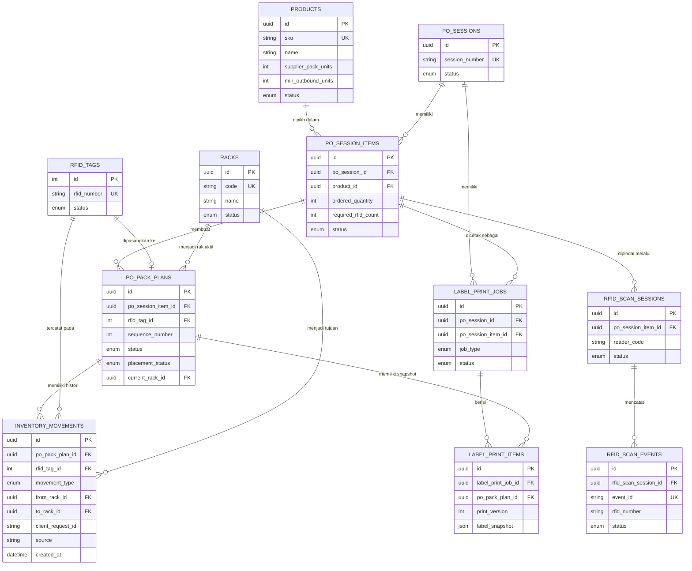

# ERD KOMAR — Admin PO/RFID dan Placement Site Employee

> Dokumen ini menggambarkan schema yang aktif saat ini. Scope yang didukung adalah
> katalog produk, persiapan session PO, assignment RFID, pencetakan label, scan
> realtime melalui Orange Pi, master rak, dan placement repack oleh site employee.
> Relocation, outbound, trash workflow, dan reuse RFID sudah didukung melalui
> lifecycle placement. Opname, autentikasi, dan multi-site belum menjadi workflow
> aktif.

## Tabel aktif

| Tabel | Fungsi sederhana |
|---|---|
| `products` | Katalog produk dan konfigurasi kemasan supplier/repack. |
| `po_sessions` | Wadah satu pekerjaan persiapan PO. |
| `po_session_items` | Produk yang dimasukkan ke dalam session PO. |
| `po_pack_plans` | Rencana paket fisik; satu paket memiliki maksimal satu RFID aktif. |
| `rfid_tags` | Inventaris UID RFID. Primary key tetap integer untuk kompatibilitas hardware/API. |
| `label_print_jobs` | Satu pekerjaan cetak awal atau cetak ulang. |
| `label_print_items` | Snapshot setiap label di dalam print job. |
| `rfid_scan_sessions` | Satu sesi pembacaan RFID realtime dari reader. |
| `rfid_scan_events` | Log setiap event UID dari reader, termasuk hasil dan error. |
| `racks` | Master rak yang dibuat Admin dan dipilih mobile. |
| `inventory_movements` | Histori placement, relocation, outbound, dan trash. |

## Relasi



## Alur data utama

```text
products
  → po_sessions
  → po_session_items
  → po_pack_plans
  → rfid_tags
  → label_print_jobs
  → label_print_items

Placement site employee:

```text
rfid_tags
  → po_pack_plans (unplaced → placed → outbound/trash)
  → racks (current_rack_id)
  → inventory_movements (placement/relocation/outbound/trash history)
```
```

Saat hardware digunakan, alurnya adalah:

```text
po_session_items
  → rfid_scan_sessions
  → rfid_scan_events
  → assignment ke po_pack_plans dan rfid_tags
```

## Catatan print job

`label_print_jobs` menyimpan riwayat pekerjaan cetak. Job awal yang sudah `generated`
atau `printed` digunakan kembali jika endpoint yang sama dipanggil ulang. Cetak ulang
yang disengaja membuat job baru dengan `job_type = reprint`.

`label_print_items.label_snapshot` adalah salinan data label pada saat job dibuat,
bukan data katalog yang selalu berubah.
